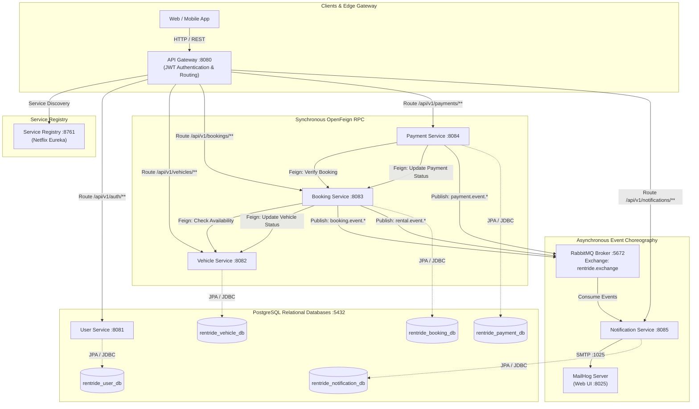

# RentRide — Cloud-Native Distributed Vehicle Rental Platform

[]()
[]()
[]()
[]()
[]()
[]()
[]()

RentRide is an enterprise-grade, cloud-native microservices platform for vehicle rental reservation, fleet onboarding, secure payment settlement, and automated customer communication. Architected using domain-driven design (DDD), database-per-service isolation, synchronous inter-service OpenFeign communication, and asynchronous RabbitMQ event choreography.

---

## Table of Contents
1. [Platform Overview & Core Services](#1-platform-overview--core-services)
2. [Architecture & Technology Matrix](#2-architecture--technology-matrix)
3. [Microservice Port & Routing Table](#3-microservice-port--routing-table)
4. [High-Level Architecture Diagram](#4-high-level-architecture-diagram)
5. [Core Business Scenarios](#5-core-business-scenarios)
6. [Step-by-Step Quickstart Guide](#6-step-by-step-quickstart-guide)
7. [Testing & Verification](#7-testing--verification)
8. [API Contracts & Swagger Documentation](#8-api-contracts--swagger-documentation)
9. [Project Directory Structure](#9-project-directory-structure)

---

## 1. Platform Overview & Core Services

RentRide decomposes vehicle rental business workflows into seven autonomous Spring Boot microservices and supporting cloud infrastructure:

- **`service-registry` (Netflix Eureka Server):** Dynamic service discovery and centralized health registration for all microservice instances.
- **`api-gateway` (Spring Cloud Gateway):** Reactive reverse proxy providing edge-level security, routing, CORS pre-flight negotiation, and stateless JWT token authentication with role claims.
- **`user-service`:** Identity management, BCrypt credential encryption, JWT token issuance, and user profile management supporting `CUSTOMER`, `PROVIDER`, and `ADMIN` roles.
- **`vehicle-service`:** Vehicle catalog, category management, dynamic multi-attribute inventory search, provider fleet management, and operational state tracking (`AVAILABLE`, `RENTED`, `MAINTENANCE`).
- **`booking-service`:** Reservation lifecycle state machine (`PENDING_PAYMENT` -> `CONFIRMED` -> `ACTIVE_RENTAL` -> `COMPLETED` / `CANCELLED`), booking duration calculation, vehicle availability locking, and provider handover/return inspection logging.
- **`payment-service`:** Payment checkout simulation, card gateway integration, idempotency tracking, OpenFeign settlement callbacks to `booking-service`, and transaction verification.
- **`notification-service`:** Asynchronous consumer listening on RabbitMQ topic exchange (`rentride.exchange`), rendering transactional HTML emails with Thymeleaf, and dispatching via JavaMailSender / MailHog.
- **`rentride-integration-tests`:** End-to-end integration test module using Testcontainers (PostgreSQL, RabbitMQ), REST-Assured, and Awaitility.

---

## 2. Architecture & Technology Matrix

| Layer / Domain | Technologies & Frameworks | Architectural Purpose |
|---|---|---|
| **Core Framework** | Spring Boot `3.4.5`, Spring Cloud `2024.0.1`, Java `21` | Modern enterprise runtime leveraging virtual threads and container support |
| **Service Discovery** | Spring Cloud Netflix Eureka | Dynamic instance registration, heartbeat monitoring, and client-side load balancing |
| **API Gateway** | Spring Cloud Gateway (Reactive / Netty) | Single entry point, path routing, JWT validation filter, header mutation (`X-User-*`) |
| **Inter-Service RPC** | Spring Cloud OpenFeign + Resilience4j | Declarative synchronous REST clients with fallback factories and custom error decoders |
| **Event Messaging** | Spring Boot Starter AMQP, RabbitMQ `3-management` | Durable topic exchange (`rentride.exchange`), DLQ dead-lettering, and asynchronous event publication |
| **Persistence & ORM** | PostgreSQL 15, Spring Data JPA, Hibernate 6, HikariCP | Database-per-service pattern with independent relational schemas |
| **Security & Auth** | JJWT (`0.12.6`), Spring Security, BCrypt | Stateless HMAC-SHA256 JWT tokens with role-based access control (RBAC) |
| **Templating & Mail** | Thymeleaf 3, JavaMailSender, MailHog | Transactional responsive HTML email notifications |
| **DevOps & Containers** | Multi-Stage Dockerfiles, Docker Compose v2 | Alpine minimal runtimes, layer caching, non-root users (`spring`), health checks |
| **Testing** | JUnit 5 Jupiter, Mockito, Testcontainers, REST-Assured, Awaitility | Multi-tier unit, component, Feign mock, and end-to-end integration test coverage |

---

## 3. Microservice Port & Routing Table

| Service / Container | Container Port | Host Port | Routing Prefix / Path | Primary Role |
|---|---|---|---|---|
| **`service-registry`** | `8761` | `8761` | `/` (Dashboard: `/eureka/`) | Eureka Discovery Server & Registry Dashboard |
| **`api-gateway`** | `8080` | `8080` | `/api/v1/**` | Unified Edge Proxy & Security Layer |
| **`user-service`** | `8081` | `8081` | `/api/v1/auth/**`, `/api/v1/users/**` | Authentication, JWT, and User Profiles |
| **`vehicle-service`** | `8082` | `8082` | `/api/v1/vehicles/**`, `/api/v1/categories/**` | Fleet Management & Catalog Discovery |
| **`booking-service`** | `8083` | `8083` | `/api/v1/bookings/**` | Reservation State Machine & Lifecycles |
| **`payment-service`** | `8084` | `8084` | `/api/v1/payments/**` | Payment Gateway & Feign Settlements |
| **`notification-service`**| `8085` | `8085` | `/api/v1/notifications/**` | AMQP Listener & Email Dispatcher |
| **`rentride-postgres`** | `5432` | `5432` | N/A (Relational Engine) | PostgreSQL multi-database datastore |
| **`rabbitmq`** | `5672` / `15672` | `5672` / `15672` | `/` (Web UI on `15672`) | AMQP Topic Broker & Management Console |
| **`mailhog`** | `1025` / `8025` | `1025` / `8025` | `/` (Web UI on `8025`) | SMTP Mail Sink & Web Inspector |

---

## 4. High-Level Architecture Diagram



---

## 5. Core Business Scenarios

The RentRide platform implements five end-to-end distributed business scenarios:

1. **Scenario 01 (Customer Registration & Vehicle Discovery):** Customer creates an account, authenticates via JWT, searches available inventory by location, date, price, fuel, and transmission filters, and initiates a vehicle reservation (`PENDING_PAYMENT`).
2. **Scenario 02 (Checkout & Feign Booking Confirmation):** Customer completes checkout using credit/debit card. `payment-service` verifies the transaction and triggers an OpenFeign RPC callback to `booking-service`, transitioning reservation status to `CONFIRMED`.
3. **Scenario 03 (Provider Fleet Management & RBAC):** Vehicle rental providers onboard vehicles into their fleet inventory with daily rental rates, manage specifications, and query their private fleets with role-based authorization enforced at the gateway.
4. **Scenario 04 (Vehicle Handover & Return Inspection):** Provider records physical pickup (moving booking to `ACTIVE_RENTAL` and vehicle to `RENTED`). Upon completion, provider conducts return inspection; based on condition (`GOOD` vs `REQUIRES_MAINTENANCE`), the vehicle resets to `AVAILABLE` or transitions to `MAINTENANCE`.
5. **Scenario 05 (Event-Driven Customer Notifications):** Domain events (`BookingConfirmedEvent`, `PaymentProcessedEvent`, `RentalLifecycleEvent`) are published asynchronously to `rentride.exchange`. `notification-service` generates personalized HTML emails and delivers them to customer/provider inboxes.

---

## 6. Step-by-Step Quickstart Guide

### Prerequisites
- **Java:** JDK 21 installed (`java -version`).
- **Maven:** Version 3.9+ installed (`mvn -version`).
- **Docker & Docker Compose:** Docker Desktop or Docker Engine installed and running (`docker compose version`).

### 1. Clone & Configure Environment
```bash
git clone https://github.com/Microservices-and-Cloud-Computing/RentRide.git
cd RentRide.git

# Copy configuration template
cp .env.example .env
```

### 2. Launch Entire Microservices Cluster
```bash
# Build multi-stage images and start all 10 containers in detached mode
docker compose up --build -d
```

### 3. Verify Cluster Health
Wait 45–60 seconds for cold-start database migrations and Eureka registrations:
```bash
# Check container status (all must show Up / healthy)
docker compose ps

# Verify Eureka service registrations
open http://localhost:8761
```
All six microservices (`API-GATEWAY`, `USER-SERVICE`, `VEHICLE-SERVICE`, `BOOKING-SERVICE`, `PAYMENT-SERVICE`, `NOTIFICATION-SERVICE`) will appear in Eureka with status `UP`.

### 4. Verify Database Provisioning
Inspect that PostgreSQL automatically initialized all five databases:
```bash
docker compose exec rentride-postgres psql -U postgres -c "\l"
```

---

## 7. Testing & Verification

### Running Automated End-to-End Integration Tests
RentRide includes a dedicated `rentride-integration-tests` module that spins up Testcontainers (PostgreSQL, RabbitMQ) and executes the complete 5-scenario workflow:

```bash
# Execute integration tests across the reactor
./mvnw clean verify -Dtest=*EndToEnd* -DfailIfNoTests=false -pl rentride-integration-tests
```

### Running Automated Postman Collection via Newman
An end-to-end Postman collection with dynamic chained variables is provided under `docs/postman/`:

```bash
# Run Postman test suite through the API Gateway
newman run docs/postman/RentRide_Platform_E2E.postman_collection.json \
  -e docs/postman/RentRide_Local.postman_environment.json \
  --reporters cli
```

---

## 8. API Contracts & Swagger Documentation

When running locally or via Docker Compose, interactive OpenAPI 3 (Swagger UI) documentation is accessible for each microservice:

- **API Gateway Entry:** [http://localhost:8080](http://localhost:8080)
- **User Service Swagger:** [http://localhost:8081/swagger-ui.html](http://localhost:8081/swagger-ui.html)
- **Vehicle Service Swagger:** [http://localhost:8082/swagger-ui.html](http://localhost:8082/swagger-ui.html)
- **Payment Service Swagger:** [http://localhost:8084/swagger-ui.html](http://localhost:8084/swagger-ui.html)
- **Eureka Dashboard:** [http://localhost:8761](http://localhost:8761)
- **RabbitMQ Management:** [http://localhost:15672](http://localhost:15672) (User: `guest`, Pass: `guest`)
- **MailHog Web UI:** [http://localhost:8025](http://localhost:8025)

Detailed endpoint schemas and sample requests are documented in [`docs/api/api-contracts.md`](docs/api/api-contracts.md).

---

## 9. Project Directory Structure

```text
RentRide/
├── .dockerignore                            # Docker context exclusion rules
├── .env.example                             # Environment variable template
├── docker-compose.yml                       # Full stack multi-container orchestration
├── pom.xml                                  # Multi-module root aggregator POM
├── mvnw / mvnw.cmd                          # Cross-platform Maven wrappers
│
├── api-gateway/                             # Spring Cloud Gateway (8080)
│   ├── Dockerfile                           # Multi-stage production Dockerfile
│   └── src/main/java/com/rentride/gateway/  # Security filter, route definitions
│
├── service-registry/                        # Netflix Eureka Server (8761)
│   └── Dockerfile
│
├── user-service/                            # Identity & Authentication Service (8081)
│   ├── Dockerfile
│   └── src/main/java/com/rentride/userservice/
│
├── vehicle-service/                         # Vehicle Fleet & Catalog Service (8082)
│   ├── Dockerfile
│   └── src/main/java/com/rentride/vehicleservice/
│
├── booking-service/                         # Booking & Reservation State Machine (8083)
│   ├── Dockerfile
│   └── src/main/java/com/rentride/bookingservice/
│
├── payment-service/                         # Payment Checkout & Settlement Service (8084)
│   ├── Dockerfile
│   └── src/main/java/com/rentride/paymentservice/
│
├── notification-service/                    # Async AMQP Listener & Email Service (8085)
│   ├── Dockerfile
│   └── src/main/java/com/rentride/notificationservice/
│
├── rentride-integration-tests/              # Testcontainers & REST-Assured E2E Suite
│   └── src/test/java/com/rentride/e2e/      # RentRideEndToEndWorkflowTest
│
├── docker/
│   └── postgres/
│       └── init-multiple-databases.sh       # Multi-tenant DB provisioning script
│
└── docs/
    ├── architecture/
    │   ├── system-architecture.md           # Deep-dive architecture & resilience documentation
    │   └── business-scenarios.md            # Detailed sequence diagrams for all 5 business scenarios
    ├── api/
    │   └── api-contracts.md                 # Complete API reference and cURL examples
    └── postman/
        ├── RentRide_Platform_E2E.postman_collection.json # Chained automated E2E test suite
        └── RentRide_Local.postman_environment.json       # Pre-configured environment variables
```

---

## License
This project is licensed under the MIT License — see the [LICENSE](LICENSE) file for details.
