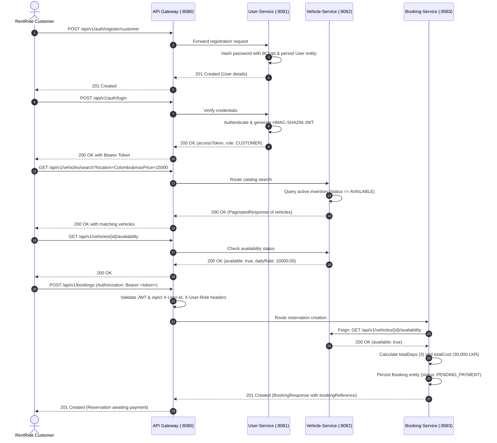
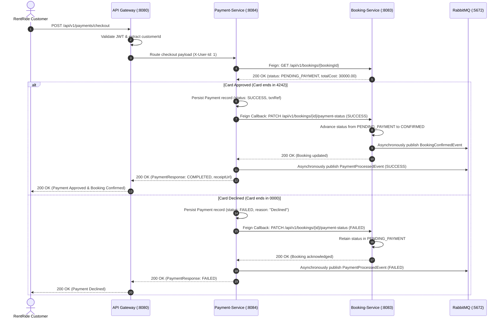
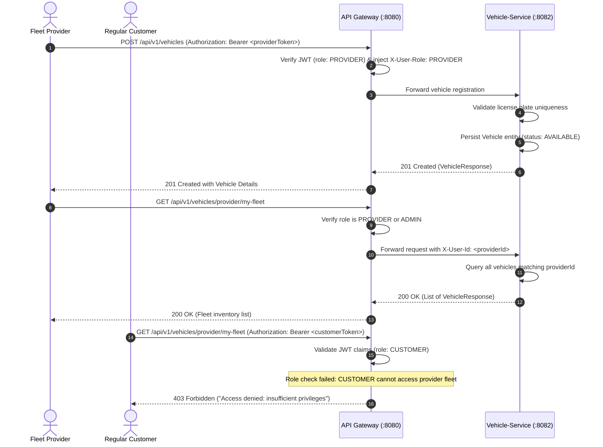
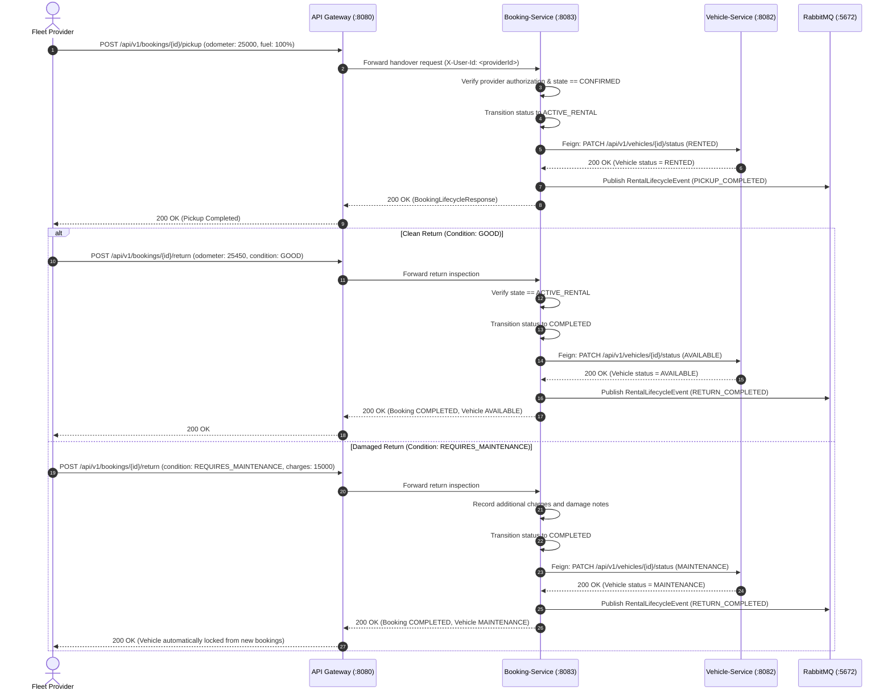
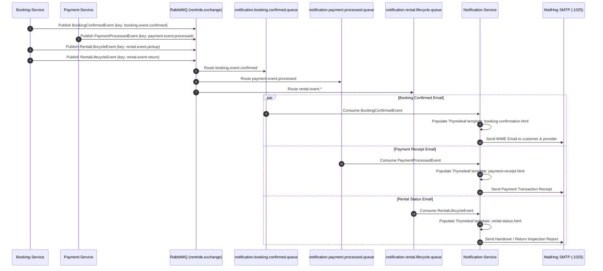

# RentRide — Core Business Scenarios & Workflow Sequence Diagrams

This document details the five core end-to-end distributed business workflows implemented across the RentRide microservices platform.

---

## Scenario 01: Customer Vehicle Discovery, Filtering & Reservation

A customer registers, logs in, browses the fleet catalog using multi-attribute criteria (location, pricing, transmission, fuel type), checks availability, and reserves a vehicle for specified dates.

---

## Scenario 02: Online Payment Execution & Feign Booking Confirmation

The customer settles the reservation cost using a payment card. `payment-service` verifies the booking, invokes the card gateway simulator, updates transaction status, and invokes an OpenFeign callback to `booking-service` to confirm the reservation.

---

## Scenario 03: Rental Provider Fleet Onboarding & Rate Management

A registered rental fleet provider logs in, onboards a new vehicle with specifications (make, model, license plate, daily rate, location), and manages their private fleet with role-based access control.

---

## Scenario 04: Vehicle Handover (Pickup) & Return Inspection Cycle

The customer arrives at the provider branch to collect the vehicle. The provider logs the handover (pickup metrics). Later, upon return, the provider inspects condition and logs odometer, fuel, and damages, synchronizing both booking and vehicle states.

---

## Scenario 05: Asynchronous Event Messaging & Customer Notifications

Transactional domain events raised by `booking-service` and `payment-service` are queued in RabbitMQ and processed asynchronously by `notification-service`, which renders responsive Thymeleaf HTML templates and delivers emails via MailHog.

