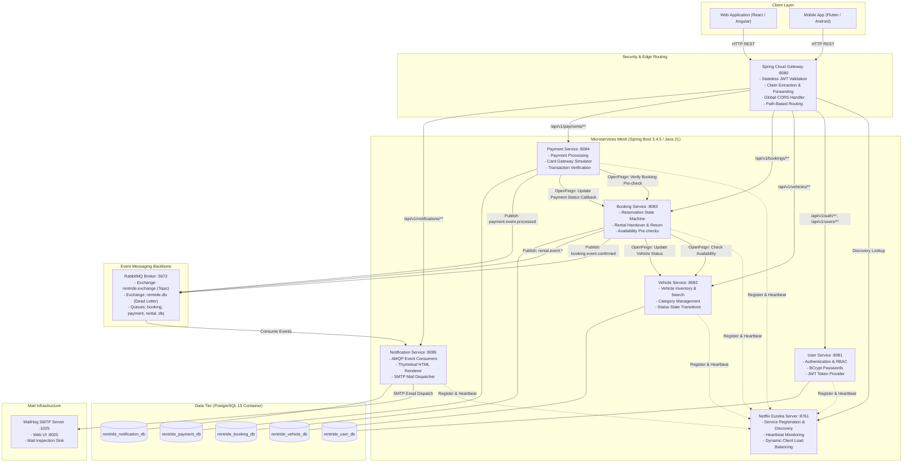
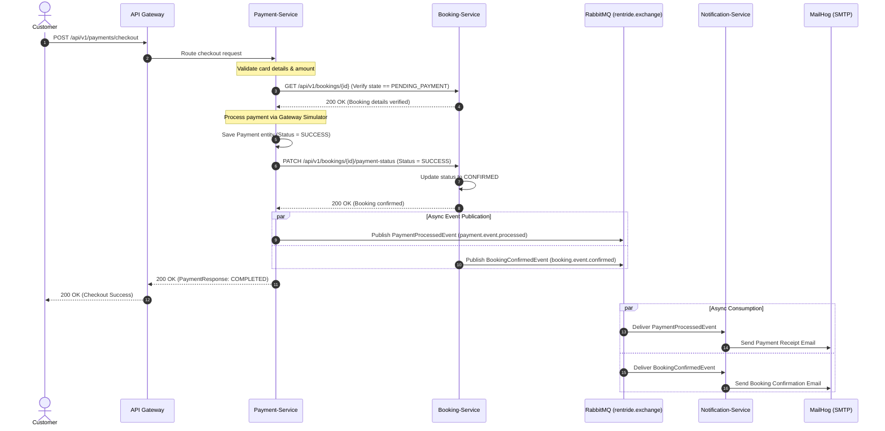

# RentRide — Distributed System Architecture & Design Documentation

## 1. System Context & Component Architecture

RentRide is structured as a decentralized, cloud-native microservices architecture designed to handle high-throughput vehicle rentals, dynamic pricing, concurrent inventory booking, and real-time customer event notifications.

### High-Level Architecture Diagram



---

## 2. Distributed Transaction Strategy

In a microservices architecture with a database-per-service pattern, distributed ACID transactions (2PC) are avoided due to latency and availability concerns (CAP theorem). RentRide combines **Synchronous Orchestration** with **Choreographed Eventual Consistency**:

### 1. Synchronous Feign Invocations (Critical Invariants)
- **Vehicle Availability Check:** Before creating a reservation in `booking-service`, it invokes `vehicle-service` via OpenFeign (`GET /api/v1/vehicles/{id}/availability`) to verify the vehicle exists and is in `AVAILABLE` state.
- **Payment Verification:** Before charging a card, `payment-service` calls `booking-service` (`GET /api/v1/bookings/{id}`) to confirm the reservation is in `PENDING_PAYMENT` state and the checkout amount matches the booking's calculated total cost.
- **Settlement Callback:** Upon card approval, `payment-service` invokes `PATCH /api/v1/bookings/{id}/payment-status` to transition the booking state atomically from `PENDING_PAYMENT` to `CONFIRMED`.

### 2. Asynchronous Event-Driven Choreography (Decoupled Notification Delivery)
- Once the database transaction commits in `booking-service` or `payment-service`, domain events are dispatched asynchronously over RabbitMQ:
  - `BookingConfirmedEvent` on routing key `booking.event.confirmed`
  - `PaymentProcessedEvent` on routing key `payment.event.processed`
  - `RentalLifecycleEvent` on routing key `rental.event.pickup` and `rental.event.return`
- `notification-service` independently consumes these messages, generates responsive HTML templates, and sends emails without blocking caller response latency or tying transaction boundaries together.



---

## 3. Resilience, Fault Tolerance & Recovery Patterns

### 1. Declarative OpenFeign Client Fallbacks
Every inter-service Feign client defines a resilient `FallbackFactory`:
- **`VehicleServiceClientFallbackFactory`:** When `vehicle-service` is unreachable or times out, the fallback returns safe default availability responses (`available: false`) with meaningful failure logging, preventing cascading failures in `booking-service`.
- **`BookingServiceClientFallbackFactory`:** If `booking-service` fails during payment callback, the payment record is marked with `REQUIRES_RECONCILIATION` and a high-priority compensation alert is logged for automated operational remediation.

### 2. Custom Feign Error Decoders
- Downstream HTTP 4xx and 5xx errors are caught by `CustomFeignErrorDecoder`.
- Specific domain exceptions (`VehicleNotFoundException`, `BookingNotFoundException`, `InvalidBookingStateException`) are re-instantiated in the caller context preserving original error codes and diagnostic messages.

### 3. Edge Security & Claim Propagation
- Edge-level token verification occurs within `AuthenticationFilter` in `api-gateway`.
- Decoded JWT claims (`userId`, `email`, `role`) are injected as downstream request headers (`X-User-Id`, `X-User-Email`, `X-User-Role`).
- Internal microservices read these trusted headers without re-verifying the JWT cryptographic signature on every hop.

### 4. RabbitMQ Dead Letter Exchange (DLQ) Strategy
```text
Topic Exchange: rentride.exchange
  ├── routing key: booking.event.confirmed ──> notification.booking.confirmed.queue
  ├── routing key: payment.event.processed ──> notification.payment.processed.queue
  └── routing key: rental.event.*          ──> notification.rental.lifecycle.queue

Dead Letter Exchange: rentride.dlx
  └── routing key: #                       ──> notification.dead-letter.queue
```
- Exponential backoff retry is configured on consumers (3 attempts, initial interval 2000ms, multiplier 2.0).
- If consumer execution fails repeatedly (e.g., SMTP outage or malformed payload), the message is routed to `notification.dead-letter.queue` without re-queuing, avoiding poison-pill crashes.
